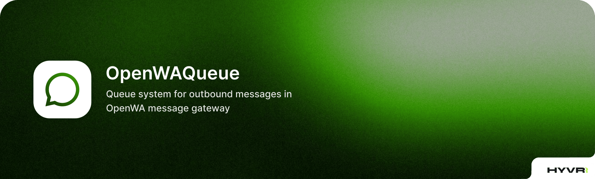

**OpenWAQueue** is a queue system for outbound messages, with an admin panel, built for [OpenWA](https://github.com/rmyndharis/openwa). Instead of calling OpenWA directly, your apps send requests to OpenWAQueue, which stores them and delivers them to OpenWA one at a time with a short random delay between each. It is written in Go and uses Bootstrap 5 and jQuery for the UI. It ships as a **single binary** with all templates and assets built in, stores its data in a local SQLite database and listens on port **3000** (queue API) and port **5000** (admin panel).

## :zap: Features

- **Queue API**: send OpenWA message requests (text, image, video, audio, document, location, contact, sticker, poll, bulk) to OpenWAQueue and get an instant `202 Accepted` response with the queue ID.
- **API key protection**: only requests with a valid `X-Queue-API-Key` header are queued. The key is generated on first startup and can be viewed and regenerated in the admin panel.
- **Throttled delivery**: requests are sent to OpenWA one by one in order, with a random 2 to 5 second delay between them.
- **Admin panel**: see pending, done and failed requests along with the OpenWA response and status code.
- **Queue controls**: pause and resume delivery, delete a single request or clear the whole queue.
- **Automatic cleanup**: only the latest 1000 processed requests are kept.
- **First-time setup**: set the admin password and the OpenWA URL and API key from the browser, or through environment variables.
- **Dark, responsive UI**: works on desktop, tablet and mobile.

## :gear: Requirements

- Ubuntu server (x86_64 or arm64)
- A running [OpenWA](https://github.com/rmyndharis/openwa) instance and its API key (created for you in the Docker method)
- For the Docker method: Docker with Docker Compose v2

## :rocket: Installation & usage

You can install OpenWAQueue in two ways: with Docker or directly on the server (bare metal).

### Method 1: Docker

The included `docker-compose.yml` runs OpenWA and OpenWAQueue together. OpenWAQueue reads the OpenWA API key automatically from the shared volume.

1. Clone the repository:

```bash
git clone https://github.com/hyvr-official/OpenWAQueue.git
cd OpenWAQueue
```

2. Set the admin password in a `.env` file next to `docker-compose.yml`:

```bash
echo "ADMIN_PASSWORD=your-strong-password" > .env
```

3. Start the containers:

```bash
docker compose up -d
```

4. Open `http://127.0.0.1:5000` and log in with your password.

Both ports are bound to `127.0.0.1` only. Put a reverse proxy in front of them, or change the `ports` in `docker-compose.yml`, if you need access from other machines.

Useful commands:

```bash
docker compose logs -f openwaqueue   # Follow the logs
docker compose restart openwaqueue   # Restart OpenWAQueue
docker compose down                  # Stop everything
```

To update, restart the container with `docker compose restart openwaqueue`. It downloads the latest release on every start. Run `docker compose pull && docker compose up -d` to update OpenWA as well.

### Method 2: Bare metal

1. Download the latest release for your server's architecture (`x86_64` or `arm64`) and install it:

```bash
ARCH=$(uname -m); [ "$ARCH" = "aarch64" ] && ARCH=arm64
sudo mkdir -p /opt/openwaqueue
wget -qO- "https://github.com/hyvr-official/OpenWAQueue/releases/latest/download/openwaqueue_linux_${ARCH}.tar.gz" | sudo tar -xz -C /opt/openwaqueue
```

   Or build the binary yourself by following [How to build](#hammer_and_wrench-how-to-build).

2. Create the configuration file:

```bash
sudo nano /opt/openwaqueue/.env
```

```env
OPENWA_BASE_URL=http://127.0.0.1:2785
OPENWA_API_KEY=your-openwa-api-key
ADMIN_PASSWORD=your-strong-password
API_PORT=3000
ADMIN_PORT=5000
DB_PATH=data/queue.db
```

3. Create a systemd service at `/etc/systemd/system/openwaqueue.service`:

```ini
[Unit]
Description=OpenWAQueue
After=network.target

[Service]
WorkingDirectory=/opt/openwaqueue
ExecStart=/opt/openwaqueue/openwaqueue
Restart=always

[Install]
WantedBy=multi-user.target
```

4. Start it:

```bash
sudo systemctl daemon-reload
sudo systemctl enable --now openwaqueue
```

5. Open `http://<your-server-ip>:5000` in your browser. If you did not set `ADMIN_PASSWORD` or the OpenWA details in `.env`, you will be taken to `/setup` to enter them.

Useful commands:

```bash
systemctl status openwaqueue      # Check the service status
journalctl -u openwaqueue -f      # Follow the logs
systemctl restart openwaqueue     # Restart OpenWAQueue
```

To update, download the new release into `/opt/openwaqueue` again and restart the service. Your `.env` and the `data` folder are kept.

### Configuration

| Variable          | Description                                   | Default         |
| ----------------- | --------------------------------------------- | --------------- |
| `OPENWA_BASE_URL` | Base URL of the OpenWA server, `/api` is added automatically |                 |
| `OPENWA_API_KEY`  | OpenWA API key, sent as the `X-API-Key` header |                 |
| `ADMIN_PASSWORD`  | Admin panel password                          |                 |
| `API_PORT`        | Port of the queue API                         | `3000`          |
| `ADMIN_PORT`      | Port of the admin panel                       | `5000`          |
| `DB_PATH`         | Path of the SQLite database                   | `data/queue.db` |

### Sending messages through the queue

Use the queue API like the OpenWA API, but on port `3000`. The method, path, query string and body are stored and forwarded to `OPENWA_BASE_URL` as they are. A leading `/api` in the path is optional.

#### Authentication (`X-Queue-API-Key`)

Every request to the queue API must include the queue API key in the `X-Queue-API-Key` header.

- The key is generated automatically on the first startup, saved in the SQLite database and printed in the console (`Queue API key (send as X-Queue-API-Key header): owq_...`).
- You can view, copy and regenerate it in the admin panel under **Settings**. Regenerating it makes the old key stop working immediately.
- A missing or wrong key returns `401 Unauthorized`.

#### Allowed endpoints

Only `POST` requests to the following endpoints are accepted. Any other method or path returns `404`.

- `/api/sessions/:sessionId/messages/send-text`
- `/api/sessions/:sessionId/messages/send-image`
- `/api/sessions/:sessionId/messages/send-video`
- `/api/sessions/:sessionId/messages/send-audio`
- `/api/sessions/:sessionId/messages/send-document`
- `/api/sessions/:sessionId/messages/send-location`
- `/api/sessions/:sessionId/messages/send-contact`
- `/api/sessions/:sessionId/messages/send-sticker`
- `/api/sessions/:sessionId/messages/send-poll`
- `/api/sessions/:sessionId/messages/send-bulk`

#### Example

```bash
curl -X POST http://127.0.0.1:3000/api/sessions/my-session/messages/send-text \
  -H "Content-Type: application/json" \
  -H "X-Queue-API-Key: YOUR_QUEUE_API_KEY" \
  -d '{"chatId": "1234567890@c.us", "text": "Hello"}'
```

Response:

```json
{ "queued": true, "id": 1 }
```

Check the status of the queue API with `GET /health`. Requests larger than 32 MB are rejected.

## :hammer_and_wrench: How to build

You can build the binaries or do development of OpenWAQueue by following the below steps. OpenWAQueue is built fully on Golang and Goreleaser is used for building releases. So you should install the latest version of Go from [here](https://go.dev/doc/install).

* Clone the project from Github.
* Run `go mod download` command to install all mods.
* Install Goreleaser by running `go install github.com/goreleaser/goreleaser/v2@latest`
* Run `build.bash` if you are building from Linux.
* Run `build.bat` if you are building from Windows.
* Build will be generated in the `./dist` folder

For development with live reload, install [Air](https://github.com/air-verse/air) and run `air` in the project folder.

## :page_with_curl: License

OpenWAQueue is open-source software licensed under the [MIT License](LICENSE).
